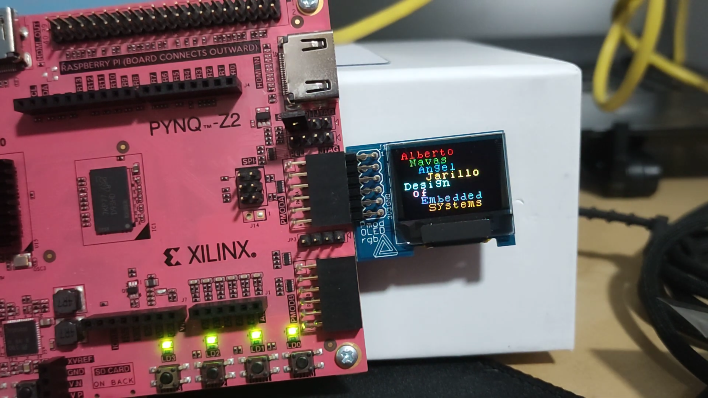
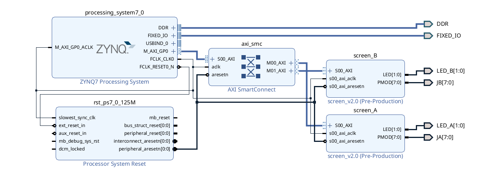

# pmod-oled-rgb

Project for **Design of Embedded Systems**, a subject from my Master's Degree in Industrial Electronics.

<div align="center">

</div>

***

## Contents

- [Requirements]()
- [Project Overview](#project-overview)
- [Steps](#steps)
- [Design](#design)
    - [The VHDL Block](#the-vhdl-block)
    - [Vivado project: screen](#vivado-project-screen)
    - [Packaging the IP](#packaging-the-ip)
    - [Vivado project: axi_screen](#vivado-project-axi_screen)
    - [Embedded OS: Petalinux](#embedded-os-petalinux)
    - [Embedded SW](#embedded-sw)
        - [Basic test](#basic-test)
        - [Screen](#screen)
        - [External resources used](#external-resources-used)

***

## Requirements

Vivado: **2025.1**

Petalinux: **2025.1**

Board: **PYNQ-Z2**

***

## Project Overview


The aim of this project was to design a VHDL block in the PL, package it in an IP, build a hardware platform and control the driver (in the PL) from the PS.

This driver can be controlled from a baremetal application or from an application running in an Operating System.

The system will control the [Pmod OLEDrgb][pmod-oled-rgb] screen via SPI commands.

Here is a little demo video of it working, executing some demo functions, such as the standard provided by the screen
(drawing a full screen of pixels, drawing lines, squares, copy-pasting sections of the screnn) and some custom-built
(showing an image, drawing characters and strings).

[PMOD OLED RGB Demo][youtube-demo]

This was the first version of the project.

To see the code, go to the `old_version`

Currently I am working on the second version, with some enhacements: add support for a second screen, build the embedded operating system with petalinux, show the FPGA IP address on one of the screens, etc.
This is the work described now.

## Steps

Generate hardware platform

    $ cd hw/vivado_axi_screen
    $ ./generate_hw_platform

Generate Petalinux image

    $ cd os
    $ ./generate_petalinux_image

Package OS in SD card (already partitioned)

    $ cd os
    $ ./package_sd_image.sh

Compile and send `basic_test` software to the board

    $ cd sw/basic_test/linux
    $ make compile
    $ make send

Compile and send `screen` software, scripts and assets to the board

    $ cd sw/screen
    $ make deploy

## Design

### The VHDL block

The base of this design is the VHDL block, which will later be packaged into an AXI4Lite IP.

The architecture is really simple:

```
└── screen_controller
    └── spi_master
```

The core block is `spi_master`.

In the first version of the project, I created from scratch an `spi_master` block with a fixed speed (1MHz SCK) and also fixed to work in SPI mode 3.

For this second version, I decided to get an `spi_master` block from [OpenCores][open-cores], which is configurable and much more sofisticated.
I configured it for SPI mode 3 (required by the Pmod OLED RGB) and used a 6.25MHz SCK (125MHz clk input with 20 clock divider). The maximum SCK allowed by the screen is 6.6MHz.

The upper level block is `screen_controller` and behaves as follows:

When putting a `1` in `ON_OFF`, the turning_on sequence is executed (some required steps to correctly start using the Pmod OLED RGB, such as managing `POWER_RESET`, `VCC_ENABLE` and `PMOD_ENABLE`, and sending some SPI commands to set the default settings). More info about this can be found in the [Reference Manual][pmod-oled-rgb-reference-manual].

`ON_OFF_STATUS` indicates:
- `00` OFF
- `01` Turning ON
- `10` Turning OFF
- `11` ON

When the screen is `ON`, the block bypasses the control signals to the `spi_master` block. In the other states, these control signals are managed internally to execute the aforementioned sequences.

When `SPI_READY` shows a `1`, we can send a byte through SPI, because there is no SPI transtaction in progress.

To start an SPI transaction:
- Put the 8 bit data in `BYTE`
- Set `DC_SELECT` to `0` (data) or `1` (command)
- Set `SPI_TRIGGER` to `1`

The byte will be sent and the block will request another byte putting a `1` in `SPI_DATA_REQUEST`. This allows for continous data transmit (used when executing the `TURNING_ON` and `TURNING_OFF` sequence directly in hardware).
If no more bytes are sent, the transaction will end and `SPI_READY` will show a `1`.

***

### Vivado project: screen

To create and test the `screen_controller` block, there is a Vivado project called `screen`.

The project can be replicated as follows:

    $ cd hw/vivado_screen
    $ ./generate_screen.sh

This project has the following hierarchy:

```
└── top
    ├── screen_controller
    │   └── spi_master
    └── screen_tester
```

The behaviour of `screen_controller` is explained above.

The block `screen_tester` works as follows: if `ON_OFF_STATUS` is ON and `screen_tester` receives a rising edge in  its `ENABLE`, it sends the "ENTIRE_DISPLAY_ON" command, making all the pixels in the screen white.
If it receives a falling edge in its `ENABLE`, it sends the "ENTIRE_DISPLAY_OFF" command, putting all pixels to black.

The `top` module instantiates `screen_controller` and `screen_tester` and makes the necessary connections
This way, we have a physical test to see that the commands sent to the screen work.

- SW0: `ON_OFF` of screen_controller
- SW1: `ENABLE` of screen_tester
- LED0: `ON_OFF_STATUS`(0)
- LED1: `ON_OFF_STATUS`(1)
- LED2: `SPI_READY`
- LED3: `ON_OFF`

In this project, there are also testbenches, for the `spi_master`, `screen_controller` and `screen_tester`.
They can be set as top in the simulation folder to be individually executed with Vivado simualtor, and see how each block works.

***

### Packaging the IP

Once I had the VHDL block working and tested, it is the moment to package it in an AXI4Lite IP.

In a Vivado project, in the top bar:
 - Tools > Create and Package New IP > Create AXI4 Peripheral > [...] > Add IP to repository.

Then, going to the IP Catalog, it can be edited with the IP Packager. It creates a project, where we need to add the user logic blocks (`screen_controller` and `spi_master`).

With this IP, I basically connected the control/write ports (ON_OFF, SPI_TRIGGER, BYTE, DC_SELECT) and the status/read ports(ON_OFF_STATUS, SPI_READY, SPI_REQUEST_DATA) to the AXI registers of the IP block.

The outputs of the IP are:
- **PMOD[7:0]** Pmod pins, connected to the OLED display.
- **LED[1:0]** To indicate ON_OFF_STATUS, as descibed before. This will give visual aid when turning on and off the screen.

After this is done, we can re-package the IP and close the temporal project.

**SCREEN IP REGISTER MAP**

- Slave Register 0 (slv_reg0) (WRITE)
    - Bits 31:1  : Reserved
    - Bit 0      : ON_OFF (W) Control signal to turn ON/OFF the screen

- Slave Register 1 (slv_reg1) (READ)
    - Bits 31:2  : Reserved
    - Bits 1:0   : ON_OFF_STATUS (R) Status signal to indicate if the status of the screen is ON/OFF
        - 00: Screen OFF
        - 01: Screen turning ON
        - 10: Screen turning OFF
        - 11: Screen ON

- Slave Register 2 (slv_reg2) (WRITE)
    - Bits 31:10 : Reserved
    - Bit 9      : SPI_TRIGGER (W) Control signal to trigger sending the BYTE to the screen via SPI
    - Bit 8      : DC_SELECT (W) Control signal to select Data/Command for the BYTE to send
        - 0: Data
        - 1: Command
	- Bits 7:0   : BYTE (W) Byte to send to the screen via SPI

- Slave Register 3 (slv_reg3) (READ)
	- Bits 31:2  : Reserved
	- Bit 1      : SPI_DATA_REQUEST (R) Status signal to indicate that the screen_controller is ready to receive a new BYTE to send via SPI
	- Bit 0      : SPI_READY (R) Status signal to indicate that the screen_controller has finished sending the previous BYTE via SPI

***

### Vivado project: axi_screen

To generate what will be the final hardware platform, I created the vivado project `axi_screen`.

The project can be replicated as follows:

    $ cd hw/vivado_axi_screen
    $ ./generate_axi_screen.sh

This project only has the HDL wrapper of the block diagram from the picture.

<br>

<div align="center">

</div>

<br>

In the block diagram, we can see the ZYNQ Processing System connected through AXI interface to 2 `screen` IP blocks.
The physical output ports of the screen IP are the PMOD and 2 LEDs (which show ON_OFF_STATUS).

We can generate the bitstream and after that export the hardware platform (a file with .xsa extension).
 - Files > Export > Export Hardware > Include Bitstream

To do all these steps automatically (create the project, generate the bitstream and export the hardware platofrm) execute the following script:

    $ ./generate_hw_platform.sh


To test if this hardware platform works correctly, we can open Vitis (Tools > Launch Vitis IDE).
We select a workspace or create a new one in a desired folder.

> [!TIP]
> It is recommended to use a Vitis workspace with a short path, such as `$HOME/vitis_ws` or else we can have some problems when trying to compile the hardware platform or the application

Once we have a Vitis workspace, we create a hardware platform based on the `.xsa` we exported before and compile it.

Then we create an application project from the templates: Empty Application.
In `Sources > src` we add the C program `screen_test.c` (available in the repo: `sw/basic_test/baremetal/screen_test.c`).
We can now build it and run it.
We will see how the LEDs will turn ON (meaning ON_OFF_STATUS from screens A and B are ON "11") and how the screens receive the command "ENTIRE_DISPLAY_ON".

<br>

<div align="center">

</div>

<br>

The screens are connected with 6x2 dupont cables because both can't fit directly in the PMOD connectors side by side.

I decided not to create any scripts to replicate the Vitis project, as it is easier than the Vivado projects and its only purpose is to perform a quick test of the hardware platform.
The further development will be done with the Petalinux OS.

> [!CAUTION]
> There is a typo in the Makefile created by the Vivado IP packager.
> This typo doesn't affect the standalone project created by Vitis, but generates an error when building the petalinux OS.
> The typo needs to be corrected as follows:
>   ```
>   LIBSOURCES=($wildcard *.c) --> LIBSOURCES=$(wildcard *.c)
>   OUTS = ($wildcard *.o)     --> OUTS = $(wildcard *.o)
>   ```
> Once this is done, it is necessary to repackage the IP and regenerate the hardware platform.

***

### Embedded OS: Petalinux

The petalinux project is stored in the repo, and the image can be regenerated executing the script:

    $ cd os
    $ ./generate_petalinux_image

The necessary files to boot the OS from an SD card will appear in the dir `os/petalinux_screen/images/linux`.

The SD card has to be formatted with two partitions:
- **Unallocated**. 4MB of preceding space
- **BOOT**. Formatted to fat32, recommended minimum of 500MB.
- **rootfs**. Formated to ext4, take the rest of the space in the SD card.

Once it is formatted (using a tool as `parted` or `gparted`), mount the SD card partitions and assuming they have been mounted in `/media/$USER/BOOT` and `/media/$USER/rootfs`, execute the following script:

    $ cd os
    $ ./package_sd_image.sh

The SD is ready to be plugged in the PYNQ-Z2.

Custom details applied to Petalinux:

- **EXT4 rootfs**. Requires to be extracted into the SD before the first boot up, but it is permanent between reboots.
- Fixed MAC address and let IP address get automatically assigned.
- glibc to support C applications.
- libstdc++ to support C++ applications.
- UIO driver support.
- ntp to get correct time and date.
- rsync to improve file sync.
- Enable debug-tweaks to allow root SSH login (and disabled empty password)
- Changed from sysvinit to systemd.
- Added petalinux app to execute script at boot time that will launch `service_app`.

### Embedded SW

Once the Petalinux OS is up and running, the C/C++ software can be compiled, loaded and executed.

In principle, petalinux provides a custom toolchain, than can be generated and extracted with the following commands:

    $ petalinux-build --sdk
    $ petalinux-package sysroot --sdk <custom sdk path> --dir <custom directory path>

These two steps can be executed with the following script:

    $ cd os
    $ ./generate_petalinux_toolchain

This is sometimes unpredictable and gets stuck on the process, so I proceeded with the standard Arm cross-compiler toolchain for 32 bit architecture:
`AArch32 GNU/Linux target with hard float (arm-none-linux-gnueabihf)`.
Version: `12.2.Rel1 (December 22, 2022)`.
Available here: [Arm GNU Toolchain Downloads][arm-toolchain].

Download it and extract it in `$HOME/tools`:

    $ tar -xvf arm-gnu-toolchain-12.2.rel1-x86_64-arm-none-linux-gnueabihf.tar.xz -C $HOME/tools

***

#### Basic test

In `sw/basic_test/linux` there are four versions of the same program to test the screens (turn it ON, send the ENTIRE_DISPLAY_ON command, send the ENTIRE_DISPLAY_OFF command and turn it OFF).
They aim to test two things:
- The toolchain works both for C and C++.
- The screen memory addresses can be accessed both through `/dev/mem` and `/dev/uioX` (being `X` the index of the screen, 0 for screenA and 1 for screenB)

They can be compiled and sent to the PYNQ-Z2 board using the `Makefile`:

    $ make compile
    $ make send

Or both steps together:

    $ make all

> [!TIP]
> The script `Makefile` sends the binaries to `pynq-z2-screen:/home/plnx`.
> This means there has to be a host alias for `pynq-z2-screen` in `$HOME/.ssh/config` with its IP and user (plnx).

Connect to the board via SSH and execute them (with sudo privileges, in order to open the file descriptor for memory interfaces):

    $ sudo ./mem_c
    $ sudo ./uio_c
    $ sudo ./mem_cpp
    $ sudo ./uio_cpp

***

#### Screen

The final version of the software is in `sw/screen`.

There are currently two applications:

- `test_app`. Instantiates screen A and screen B and tests all the features.
- `service_app`. Final application, automatically launched at boot.

To compile them and send them to the board at `/opt/screen/bin`, use the `Makefile`:

    $ make compile
    $ make send

Or both steps together:

    $ make all

To also send the scripts and the assets:

    $ make deploy

Deployed directory structure:

```
└── /opt/screen
    ├── assets
    │   ├── config.json
    │   └── images
    ├── bin
    |   ├── service_app
    |   └── test_app
    └── scripts
        └── run_service.sh
```

> [!TIP]
> If the time and date are incorrect, check the available timezones:
>
>     $ timedatectl list-timezones
>
> Set it:
>
>     $ sudo timedatectl set-timezone <desired-timezone>
>
> And check it:
>
>     $ ls -l /etc/localtime

At boot, the script `/usr/bin/screen-boot-hook.sh` is launched, executing `/opt/screen/scripts/run_service.sh`, which executes `service_app`.

This is fixed on the petalinux image. This way, the `service_app` is launched automatically, but if any modification needs to be done to the done to `service_app` or `run_service.sh`, the petalinux image does not need to be modified and regenerated.

> [!TIP]
> The script `deploy.sh` sends the binaries to `pynq-z2-screen:/opt/screen`.
> This means there has to be a host alias for `pynq-z2-screen` in `.ssh/config` with its IP and user (root).

#### External resources used

- `stb_image` library from [nothings/stb][stb_repo]
- `json` library from [nlohmann/json][json_repo]
- `8x8 font` from [dhepper/font8x8][font_repo]
- `6x8 font` derived from `8x8 font` using a python script and some manual adjustments

[comment]: (Links)
[petalinux-2024.1]: https://docs.amd.com/r/2024.1-English/ug1144-petalinux-tools-reference-guide
[pmod-oled-rgb]: https://digilent.com/reference/pmod/pmodoledrgb/start
[youtube-demo]: https://youtu.be/TNlVlC1Tnaw
[open-cores]: https://opencores.org/
[pmod-oled-rgb-reference-manual]: https://digilent.com/reference/pmod/pmodoledrgb/reference-manual
[arm-toolchain]: https://gitlab.arm.com/tooling/gnu-toolchains-for-arm
[stb_repo]: https://github.com/nothings/stb
[json_repo]: https://github.com/nlohmann/json
[font_repo]: https://github.com/dhepper/font8x8